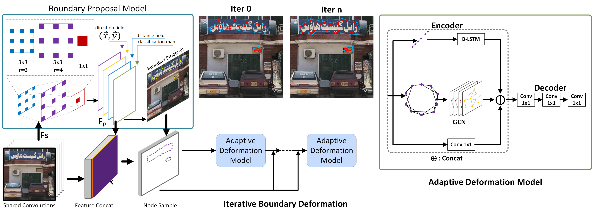
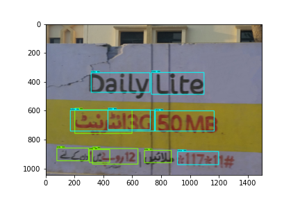
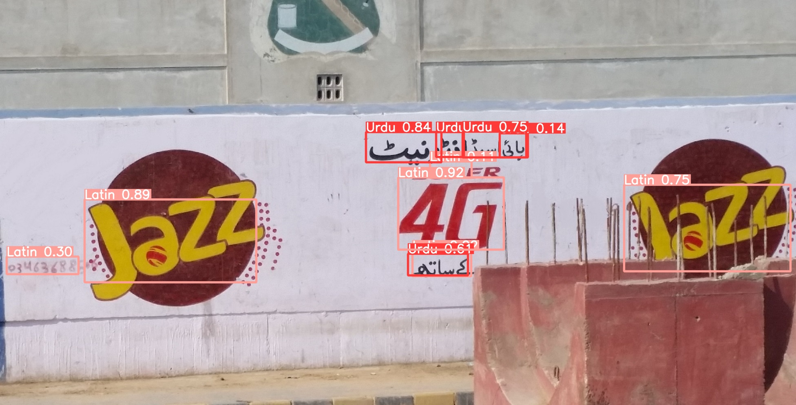
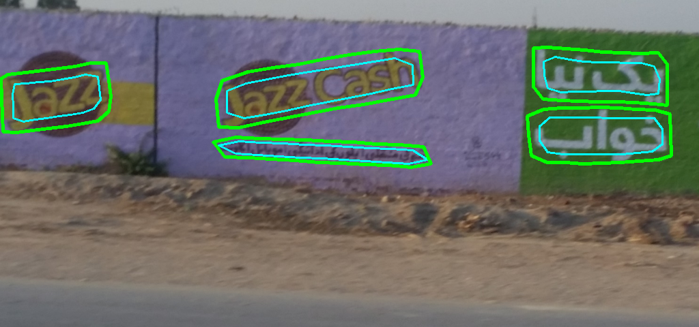
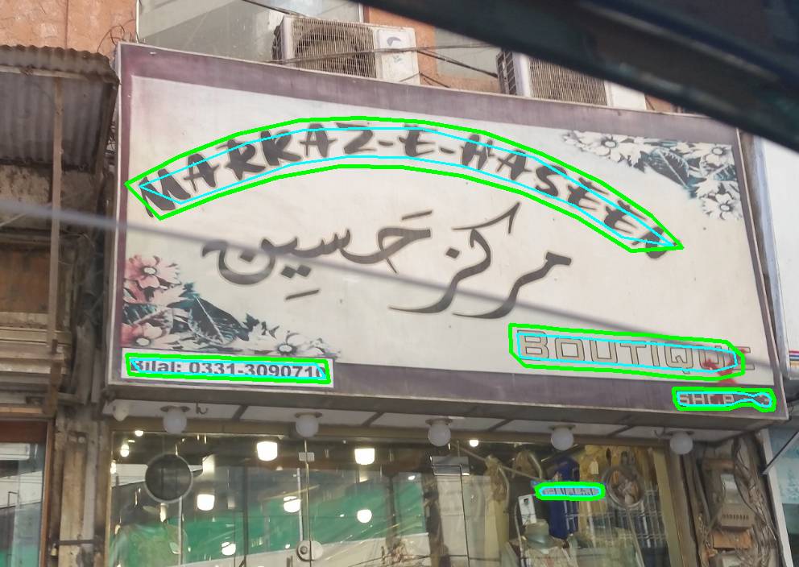
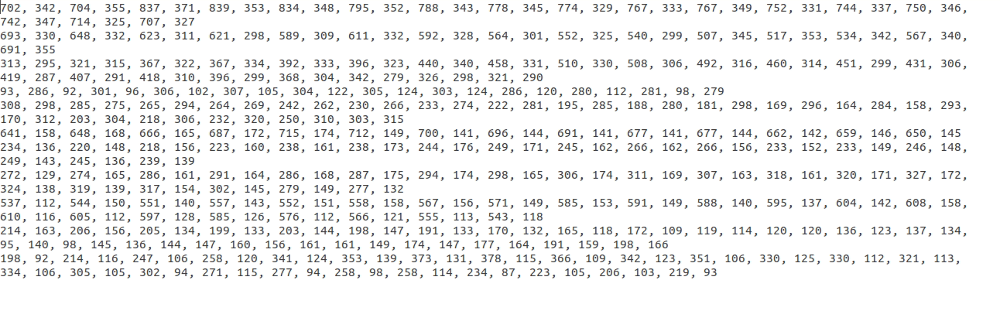

<div align="center">

# Urdu Scene Text Detection

**Finding Urdu text of any shape and orientation in real-world photos, with deep learning.**


*MPhil thesis in Data Science, Information Technology University (ITU) Lahore, 2023*
*Author: **Aamna Khan** · Supervisors: Dr. Iqra Safder, Dr. Hajra Waheed*

</div>

---



## Overview

Reading text in the wild powers translation, navigation, accessibility tools and autonomous systems. For Urdu it is much harder than for English:

- The script is **cursive**, so letters join and word shapes vary.
- Writing styles range from printed signboards to handwriting on walls.
- Text is often **curved, rotated or on busy backgrounds**, where rectangular boxes fit poorly.
- Few public resources exist for Urdu.

This project builds and compares three detectors on an Urdu scene-text benchmark. It adds **polygon annotations** so that curved text can be outlined tightly instead of boxed loosely.

## Highlights

- **Three model families compared** on the same data: YOLOv5, Faster R-CNN (ResNet-50 and MobileNet backbones, implemented from scratch), and a two-stage boundary model.
- **Boundary Proposal + Adaptive Deformation pipeline.** A CNN proposes text boundaries. A GCN + Bi-LSTM encoder-decoder then refines them over several iterations to hug the true text outline.
- **Polygon annotations** for the Urdu-Text benchmark, built on top of its quadrilateral boxes.
- **Handles arbitrary shapes.** Only the boundary model reliably followed curved, multi-oriented text on complex backgrounds.

## Results

On the Urdu-Text test set (thesis Chapter 5):

| Model | Output | Precision | Recall |
|---|---|:---:|:---:|
| YOLOv5 | Axis-aligned box | 0.83 | 0.56 |
| Faster R-CNN | Axis-aligned box | 0.81 | 0.60 |
| **Boundary Proposal + Adaptive Deformation** | **Polygon** | **1.00** | **0.65** |

The thesis also reports F-scores of 0.46, 0.50 and 0.76 respectively. See Chapter 5 for the evaluation protocol.

### Qualitative examples

| Faster R-CNN | YOLOv5 |
|:---:|:---:|
|  |  |

| Boundary model: arbitrary shape | Boundary model: oriented text |
|:---:|:---:|
|  |  |

## Method

1. **Boundary Proposal Model.** Shared convolutions feed dilated-convolution heads that predict a **classification map**, a **distance field** and a **direction field**. Together they give an initial polygon around each text instance.
2. **Adaptive Deformation Model.** Points sampled along each boundary form a graph. A **GCN** and a **Bi-LSTM** encode their local and sequential context, and a convolutional decoder predicts how far to move each point. Repeating this for *n* iterations ("Iter 0" to "Iter n" in the diagram above) snaps the boundary onto the text.
3. **Baselines.** YOLOv5 and Faster R-CNN are trained on the same split. They output rectangles, which fit curved Urdu text poorly.

## Dataset

The **Urdu-Text** benchmark has **1,400 scene images** (1,000 train, 400 test) with **13,788 labelled text regions** in Urdu, English, Sindhi and Arabic. It covers printed text on shop names, banners and street signs, and handwritten text on walls and hoardings.

Images and annotations are not redistributed here. Get the dataset from its original authors and follow the preparation steps in the thesis to produce the polygon annotations.



## Repository structure

```
faster_rcnn/    Faster R-CNN implementation: backbones, RPN, ROI head, training and testing
yolov5/         YOLOv5 custom-training notebook
textbpn/        Boundary Proposal / Adaptive Deformation code (adapted from TextBPN)
docs/           Architecture diagram, poster and result figures
```

## Getting started

Clone the repository and pick a model. Trained weights and dataset images are not included, so supply your own.

```bash
git clone https://github.com/aamna2401/urdu-text-detection-natural-scene-images-.git
cd urdu-text-detection-natural-scene-images-
```

**Faster R-CNN**

```bash
cd faster_rcnn
pip install -r requirements.txt
# place data under Dataset/{train,val,test,annotations} (COCO format)
python train.py      # configure in configurations/train_config.py
python test.py       # configure in configurations/test_config.py
```

Notebooks: `ResNet_train.ipynb` and `MobileNet_train.ipynb`.

**YOLOv5**

Open `yolov5/YOLOv5_Custom_Training.ipynb` and run the cells. They train on the converted annotations.

**Boundary Proposal / Adaptive Deformation**

```bash
cd textbpn
# Python 3.9, PyTorch 1.7, CUDA 11.1; see textbpn/README.md
sh scripts/train_Totaltxt.sh     # example training script
sh eval.sh                       # evaluation
```

Adapt the dataset loaders in `textbpn/dataset/` to the Urdu polygon annotations.

## Applications

Translation of signs and menus, assistive reading for visually impaired users, navigation and mapping, and perception for autonomous devices operating in Urdu-speaking regions.

## Acknowledgements

- **TextBPN**, Zhang et al., *Adaptive Boundary Proposal Network for Arbitrary Shape Text Detection*, ICCV 2021. Code from [GXYM/TextBPN](https://github.com/GXYM/TextBPN), MIT licensed.
- **YOLOv5** by [Ultralytics](https://github.com/ultralytics/yolov5), under its own licence.
- The **Urdu-Text** dataset authors.
- My supervisors, Dr. Iqra Safder and Dr. Hajra Waheed, and the ITU Data Science Lab.

## Citation

```bibtex
@mastersthesis{khan2023urdu,
  author = {Aamna Khan},
  title  = {Urdu Text Detection in Natural Scene Images},
  school = {Information Technology University, Lahore},
  year   = {2023}
}
```

If you build on the boundary model, please also cite the TextBPN paper (Zhang et al., ICCV 2021).

## License

The code written for this project is released under the [MIT License](LICENSE). Third-party components keep their own licences, as listed above.
